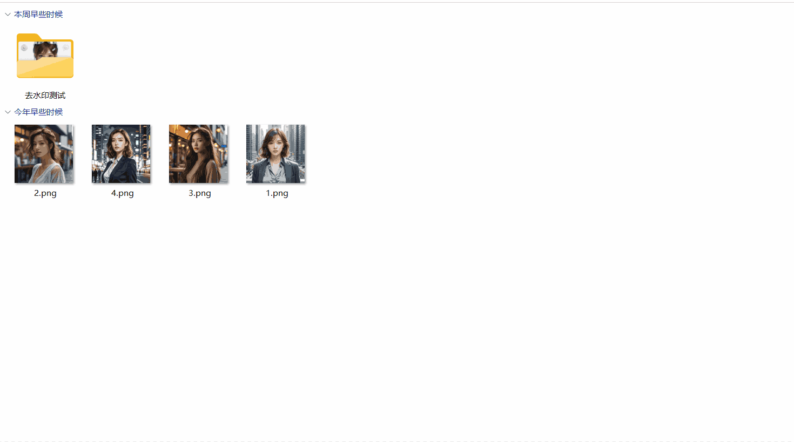

# 图片加边框

> 为图片添加实线、双线、阴影、拍立得、胶片五种边框效果，多图批量处理，可输出到指定目录或源图片目录。

---

## 核心特性

- **5 种边框样式**：实线、双线、阴影、拍立得、胶片
- **参数全可调**：边框宽度、颜色、圆角，6 种预设色一键切换
- **实时预览**：缩略图快速切换，调整参数即刻看到效果
- **多图批量**：一次性添加多张图片，点「确定添加边框」统一处理
- **输出位置可选**：留空则输出到各图源目录；也可指定统一输出目录
- **文件名后缀可配**：默认 `_bordered`，输出为 `原名_bordered.png`
- **配置自动记忆**：样式与输出设置自动保存，下次打开沿用
- **离线可用**：渲染全部在本地完成，无任何外部服务

---

## 脚本演示

* 设定边框样式并添加图片

  

---

## 安装方法

本脚本的运行环境、依赖组件及图形化窗口均依赖「不忙脚本盒子」，建议仅通过盒子安装和使用。

> 前置条件：安装好 [不忙脚本盒子](https://www.bm-box.cn)

* 打开盒子 → **脚本市场** → 搜索 **「图片加边框」**
* 点击「安装」，等待安装完成

---

## 使用方式

- **打开窗口**（任意方式都会弹出配置窗口）
  - 在盒子主界面点击「图片批量加边框」卡片
  - 在盒子「热键管理」为该脚本绑定快捷键后按下
  - 在文件夹中选中图片 → 右键 → 不忙脚本盒子 → 图片批量加边框

- **添加图片**（三选一，可混合）
  - 点「添加图片」：打开系统文件对话框，可多选（能记住源目录）
  - 点「选择图片」：用系统文件选择器多选
  - 直接把图片拖进预览区

- **设置并输出**
  - 选择边框样式、宽度、颜色、圆角，左侧缩略图可切换/移除/清空
  - **输出目录**：留空则保存到每张图片所在目录；也可点「浏览」指定统一目录
  - **文件名后缀**：默认为 `_bordered`，输出为 `原名 + 后缀 + .png`
  - 点「确定添加边框」，逐张处理并显示进度

- **完成**
  - 全部成功：提示「已输出 N 张」，窗口自动关闭
  - 有失败：窗口保留并显示失败原因，便于调整后重试

---

## 💡 使用提示

- 通过右键/快捷键触发时，已在文件管理器中选中的图片会自动带入窗口。
- 拖拽添加的图片拿不到源目录，若「输出目录」留空将无法保存，请先指定输出目录。
- 输出格式固定为 PNG（保留透明通道）；文件名后缀建议不为空，以免与源文件重名。

---

## 🖥️ 环境要求

| 项目 | 要求 |
| --- | --- |
| **操作系统** | Windows 10 1803+（64 位） |
| **运行环境** | Node.js >= 16（盒子自动下载） |
| **外部工具** | webview-cli（盒子自动下载） |
| **运行依赖** | `@napi-rs/canvas`（盒子自动安装） |

---

## 更新日志

- v1.3.0（当前最新版）
  - 交互重构：任意方式触发都弹出配置窗口，节点/定时任务静默运行
  - 支持多图批量：缩略图列表、添加/移除/清空、逐张进度
  - 新增输出目录配置（留空输出到源目录）与可自定义文件名后缀
  - 新增服务端原生文件/目录对话框；移除剪贴板功能
  - 边框样式与输出设置自动记忆

